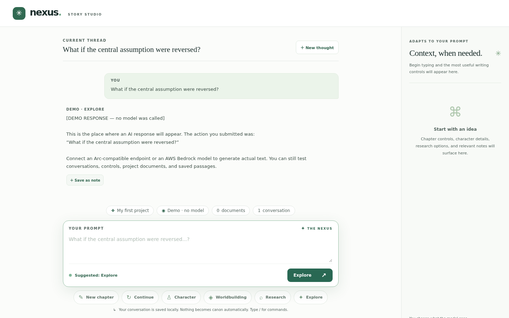

# Your first thought
Type a sentence and send it with the button or Ctrl+Enter. The reply, your message, and the whole thread are saved in the current project. Nothing becomes a chapter or a note until you save it yourself.

## 1. Type a prompt

<!-- shot:first-prompt-typed -->
> **Screenshot stub** `first-prompt-typed`: A typed prompt and the mode Nexus suggests for it.
<!-- /shot -->

TODO(example): the prompt to type, what to expect, and why it matters.

## 2. Read the reply

<!-- shot:first-reply -->

*The reply appears in a transcript, labelled with the model and mode that produced it.*
<!-- /shot -->

TODO(example): the prompt to type, what to expect, and why it matters.

## 3. Keep going in the same thread

<!-- shot:follow-up-same-thread -->
> **Screenshot stub** `follow-up-same-thread`: A second prompt continues the same conversation.
<!-- /shot -->

TODO(example): the prompt to type, what to expect, and why it matters.

## Not built yet

TODO(example): list the planned features for this area, taken from the `planned` tests.
