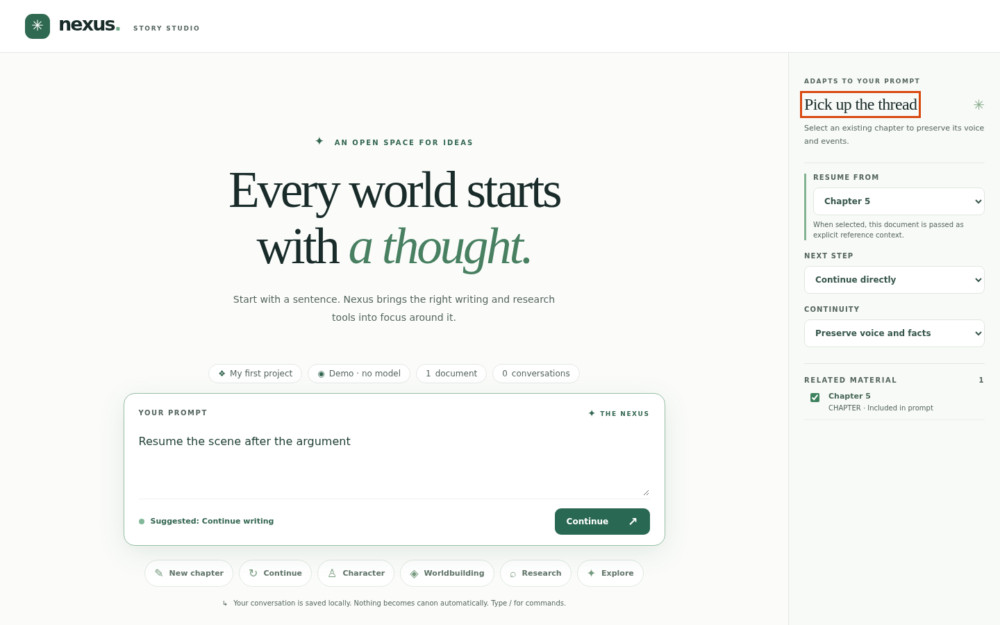

# Modes and widgets
Every prompt is classified fresh: explore, new chapter, continue, character, worldbuilding, or research. The right-hand pane shows only the controls that mode needs, and every control changes what is sent to the model.

## 1. Continue is suggested

<!-- shot:mode-continue-detected -->

*Typing a 'resume' style prompt switches the pane to the continue controls.*
<!-- /shot -->

TODO(example): the prompt to type, what to expect, and why it matters.

## 2. New chapter controls

<!-- shot:mode-draft-widgets -->
> **Screenshot stub** `mode-draft-widgets`: New chapter shows point of view, tone and scope.
<!-- /shot -->

TODO(example): the prompt to type, what to expect, and why it matters.

## 3. Research controls and the honesty note

<!-- shot:mode-research-widgets -->
> **Screenshot stub** `mode-research-widgets`: Research mode says plainly that there is no live web search.
<!-- /shot -->

TODO(example): the prompt to type, what to expect, and why it matters.

## 4. Override the suggestion

<!-- shot:mode-override-pill -->
> **Screenshot stub** `mode-override-pill`: Clicking a mode pill overrides the guess; click it again to undo.
<!-- /shot -->

TODO(example): the prompt to type, what to expect, and why it matters.

## 5. Change a control

<!-- shot:widget-values-changed -->
> **Screenshot stub** `widget-values-changed`: Changing a control changes the request that is sent.
<!-- /shot -->

TODO(example): the prompt to type, what to expect, and why it matters.

## Not built yet

TODO(example): list the planned features for this area, taken from the `planned` tests.
