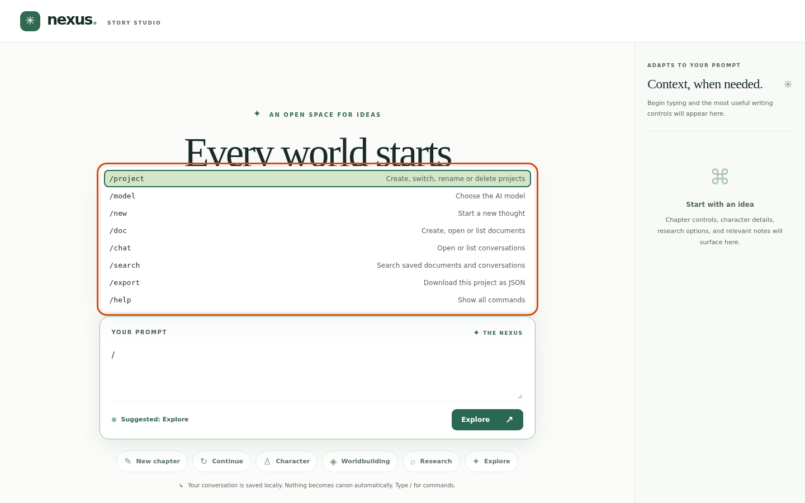

# Commands
Start a prompt with a slash to run a command. Commands run on your machine and never reach a model. Press / to see them all. Tab or Enter accepts a suggestion, the arrow keys move, and Escape closes the menu.

## 1. Press the slash key

<!-- shot:slash-menu-open -->

*Typing a slash lists every command.*
<!-- /shot -->

TODO(example): the prompt to type, what to expect, and why it matters.

## 2. Narrow it down

<!-- shot:slash-menu-doc-subcommands -->
> **Screenshot stub** `slash-menu-doc-subcommands`: After /doc the menu offers new, open and list.
<!-- /shot -->

TODO(example): the prompt to type, what to expect, and why it matters.

## 3. Typos are caught

<!-- shot:slash-typo-suggestion -->
> **Screenshot stub** `slash-typo-suggestion`: A misspelled command offers a 'Did you mean' fix.
<!-- /shot -->

TODO(example): the prompt to type, what to expect, and why it matters.

## 4. Ask for help

<!-- shot:help-toast -->
> **Screenshot stub** `help-toast`: /help lists the commands in a short message.
<!-- /shot -->

TODO(example): the prompt to type, what to expect, and why it matters.

## 5. Unknown commands are refused

<!-- shot:unknown-command-refused -->
> **Screenshot stub** `unknown-command-refused`: An unknown command is refused locally instead of being sent to a model.
<!-- /shot -->

TODO(example): the prompt to type, what to expect, and why it matters.

## Not built yet

TODO(example): list the planned features for this area, taken from the `planned` tests.
