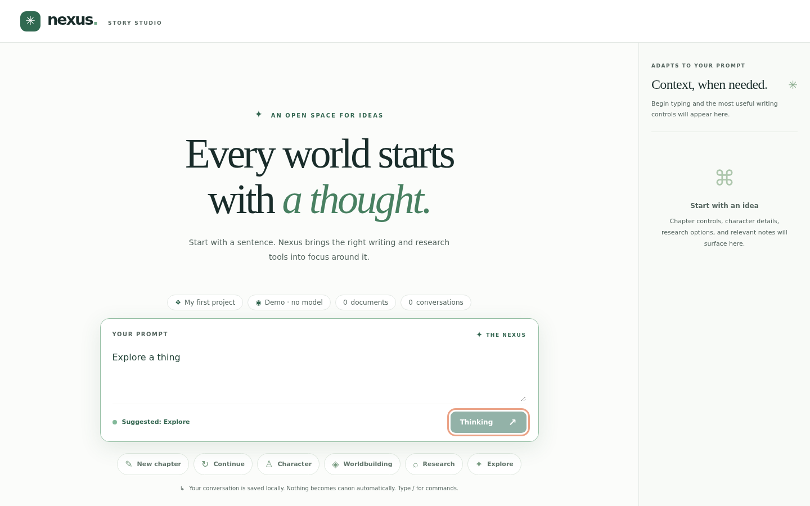

# When things go wrong
If a model fails, your prompt is kept and no reply is invented. Validation problems say what to fix. Nothing is lost when a request is refused.

## 1. A model failure keeps your words

<!-- shot:failure-prompt-kept -->
> **Screenshot stub** `failure-prompt-kept`: The failure message appears, your prompt is still in the box, and no fake reply was added.
<!-- /shot -->

TODO(example): the prompt to type, what to expect, and why it matters.

## 2. A title is required

<!-- shot:title-required -->
> **Screenshot stub** `title-required`: Saving without a title is refused and the dialog stays open.
<!-- /shot -->

TODO(example): the prompt to type, what to expect, and why it matters.

## 3. Sending is one request at a time

<!-- shot:busy-while-waiting -->

*While a request runs the button says Thinking and is disabled.*
<!-- /shot -->

TODO(example): the prompt to type, what to expect, and why it matters.

## Not built yet

TODO(example): list the planned features for this area, taken from the `planned` tests.
