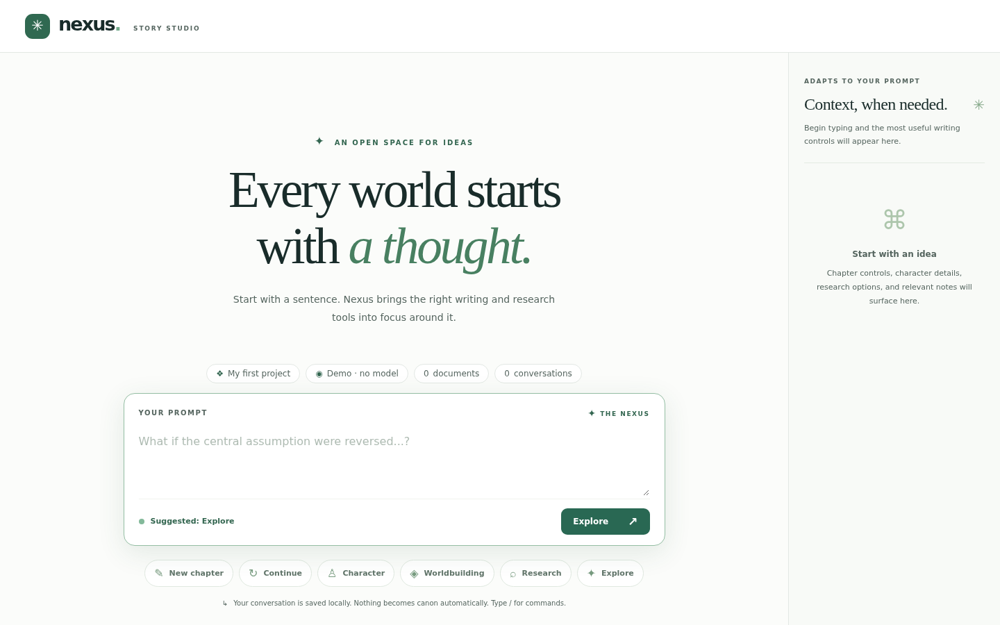

# Prompt Nexus user guide
Prompt Nexus is a writing workspace built around one prompt. You type an idea, the right tools appear beside it, and you decide what gets saved. Everything stays on your machine.

Three things are chosen separately, and none depends on the others:

- **Intent** is picked for each prompt: explore, new chapter, continue, character, worldbuilding or research.
- **Model** is picked for each request: Demo, a local Intel Arc service, or AWS Bedrock.
- **Materials** belong to a project. Only the documents you select are shown to a model.

## Pages

- [Your first thought](01-first-thought.md)
- [Modes and widgets](02-modes-and-widgets.md)
- [Commands](03-commands.md)
- [Projects](04-projects.md)
- [Models](05-models.md)
- [Documents and context](06-documents-and-context.md)
- [Saving replies and appending to a chapter](07-save-and-append.md)
- [Search and export](08-search-and-export.md)
- [When things go wrong](09-when-things-go-wrong.md)
- [Keyboard and accessibility](10-keyboard-and-accessibility.md)

## Start here

<!-- shot:home-empty-state -->

*The empty workspace: one prompt, a status strip, and nothing else to learn first.*
<!-- /shot -->

1. Type a sentence and press Ctrl+Enter.
2. Press `/` to see the commands.
3. Read [Your first thought](01-first-thought.md).

TODO(example): a short worked example that starts from this screen.
